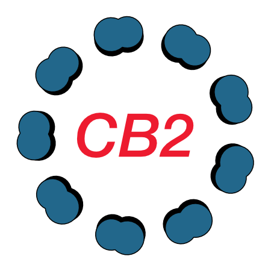
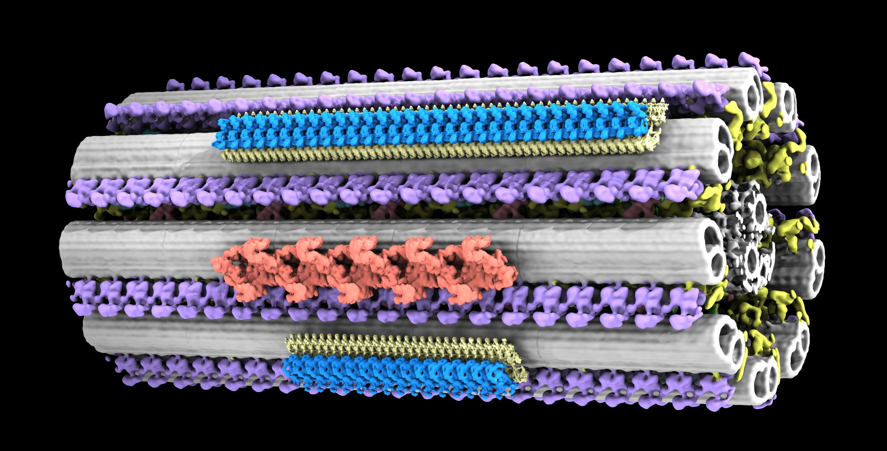

#  CiliaBuilder2



CiliaBuilder2 is a UCSF ChimeraX bundle for building and placing cilia-related models.

It focuses on a STAR-driven workflow for:

- microtubule layouts
- central pair layouts
- membrane generation
- IFT placement
- attaching maps and models onto STAR points
- geometric drawing helpers
- session save/load
- STAR import/export

## Current Scope

The main working UI is organized into three sidebar sections:

- `Build`
- `Attach`
- `Save/Load`

Build tools currently cover:

- `Microtubules`
- `Central Pair`
- `Membrane`
- `IFT`

Attachment supports common ChimeraX model types including:

- `mrc`
- `stl`
- `glb` / `gltf`
- `pdb`
- `cif` / `mmcif`

## Install In ChimeraX

Uninstall the old version in the command line of ChimeraX, type:
```bash
toolshed uninstall CiliaBuilder2
```

You can install from ChimeraX Toolshed, Tools / More Tools / CiliaBuilder2:

Alternatively, download this github and from the ChimeraX command box, install the bundle into ChimeraX with:

```bash
"devel install [Path_to_CiliaBuilder2]"
```

If you are using a different ChimeraX app bundle, replace the executable path accordingly.


## Open The Tool

After install, open the tool with the ChimeraX command:

```chimerax
cbui
```

The bundle also exposes these command entry points:

- `cbstraight`
- `buildcentralpair`
- `cbui`
- `cbopenapr`

## Quick Start

1. Find the CiliaBuilder2 in High-Order Structures
2. In `Build > Microtubules`, create a STAR model.
3. Open or load a source map/model in ChimeraX.
4. In `Attach`, choose a `STAR model` and `Map model`.
5. Click `Attach selected STAR + map`.
6. Save your scene later with `Save session JSON`.

## Tutorial

Look at the [Tutorial file](https://github.com/builab/CiliaBuilder2/blob/main/CiliaBuilder_Tutorial.pdf) to recreate all the examples below

## Example Files

Example inputs in this repo include all examples in the manuscript:

- [example 1: Chlamydomonas cilium](https://github.com/builab/CiliaBuilder2/blob/main/example/1_chlamy)
- [example 2: Chlamydomonas cilium with IFT from GLB files](https://github.com/builab/CiliaBuilder2/blob/main/example/2_chlamy_glb)
- [example 3: Sperm cilium from PDB](https://github.com/builab/CiliaBuilder2/blob/main/example/3_sperm_pdb)
- [example 4: Tetrahymena centriole](https://github.com/builab/CiliaBuilder2/blob/main/example/4_centriole)
- [example_transitionzone](https://github.com/builab/CiliaBuilder2/blob/main/example/extra_transitionzone)

You can also import external STAR files from `Save/Load > Load STAR file`.

## Session Save/Load

The session JSON workflow preserves:

- generated STAR models
- generated membranes
- attach sources
- attachments
- selected UI state

For portable sessions, copied `glb`, `gltf`, and `stl` assets are stored next to the JSON package instead of overwriting the original source files.

## STAR Workflows

Current STAR-related features include:

- building new microtubule STAR models
- continuing a microtubule build from an existing STAR model
- importing external `.star` files
- exporting the current STAR model back to `.star`

## Geometric Drawing (Experimental)

The `Attach > Geometric drawing` section provides drawing helpers that can be used for guide geometry and later export as GLB for attachment workflows.

## CellPACK Status

CellPACK-related code paths still exist in the source tree, including local APR helpers and membrane export support, but the visible cellPACK UI is currently hidden.


## Development Notes

- This project is packaged as a ChimeraX bundle, not a generic `pyproject.toml` Python package.
- Use ChimeraX `devel install` / `devel build` instead of `python -m build`.
