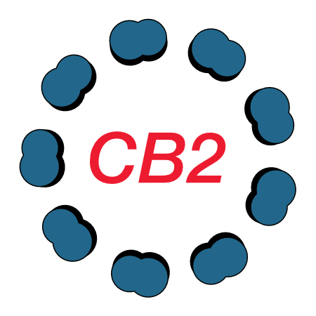
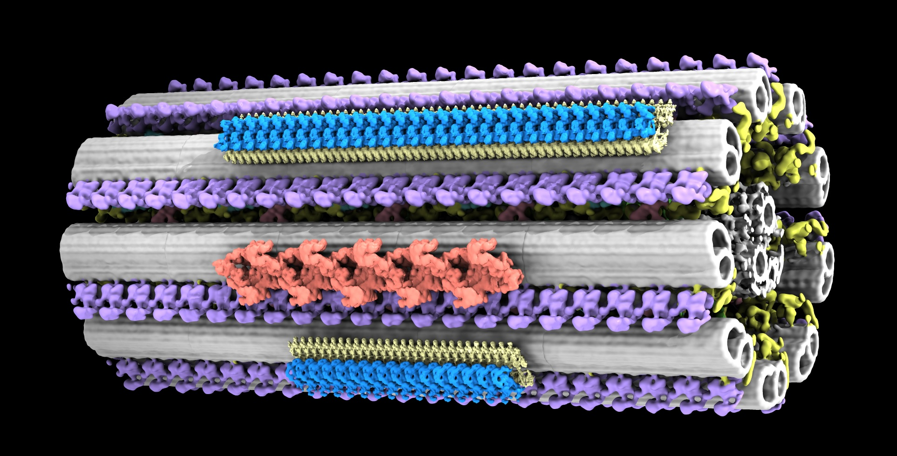

#  CiliaBuilder2



CiliaBuilder2 is a UCSF ChimeraX bundle for building and placing cilia-related models.

It focuses on a STAR-driven workflow for:

- microtubule layouts
- central pair layouts
- membrane generation
- IFT placement
- attaching maps and models onto STAR points
- geometric drawing helpers
- session save/load
- STAR import/export

## Current Scope

The main working UI is organized into three sidebar sections:

- `Build`
- `Attach`
- `Save/Load`

Build tools currently cover:

- `Microtubules`
- `Central Pair`
- `Membrane`
- `IFT`

Attachment supports common ChimeraX model types including:

- `mrc`
- `stl`
- `glb` / `gltf`
- `pdb`
- `cif` / `mmcif`

## Compatibility

Release: **0.2.1**. The bundle is named `ChimeraX-CiliaBuilder2`; its Toolshed
and Tools-menu name is **CiliaBuilder2**. It is separate from the original
[CiliaBuilder](https://github.com/builab/CiliaBuilder), which can remain installed.
The current Python package is `chimerax.ciliabuilder2`.

- Declared minimum ChimeraX version: **1.7**.
- Earlier local release smoke checks covered ChimeraX **1.7.1** and **1.11** on
  macOS; see [RELEASE.md](RELEASE.md) for their scope.
- The wheel contains pure Python and is platform independent. Windows and Linux
  need the corresponding ChimeraX installation; they have not been tested locally.
- Dependencies are ChimeraX's bundled modules and NumPy. No separate Python,
  pandas, SciPy, or ArtiaX installation is required.

## Install In ChimeraX

Download the current CiliaBuilder2 wheel from the
[GitHub releases page](https://github.com/builab/CiliaBuilder2/releases) when published.
In the **ChimeraX command line**, install the downloaded file (replace the example
path with its actual location, keeping quotes if it contains spaces):

```chimerax
toolshed install "/path/to/chimerax_ciliabuilder2-0.2.1-py3-none-any.whl"
```

Restart ChimeraX after installing or updating the bundle. You do not normally
need to uninstall the previous CiliaBuilder2 release first.

Once CiliaBuilder2 is published in the
[ChimeraX Toolshed](https://cxtoolshed.rbvi.ucsf.edu/), it can also be installed
from **Tools > More Tools** by searching for **CiliaBuilder2**.

## Install Or Build From Source

Download or clone this repository. Use the **repository root** containing
`bundle_info.xml` and `src/`, then run these commands in the ChimeraX command line:

```chimerax
devel install "/path/to/CiliaBuilder2"
```

To build a distributable wheel compatible with the declared minimum version,
run this in **ChimeraX 1.7.1**:

```chimerax
devel build "/path/to/CiliaBuilder2"
```

The wheel is written to `dist/` using the version in `bundle_info.xml`.
ChimeraX 1.7.1 may spell the filename prefix `ChimeraX_CiliaBuilder2`;
both spellings identify the same distribution. The release uses wheel metadata
version 2.1. The tested ChimeraX 1.11 builder emits metadata 2.4, which ChimeraX
1.7.1 cannot discover, so use 1.7.1 to rebuild a release for both versions.
Do not rename a wheel manually; its name and internal metadata come from
`bundle_info.xml`. See [RELEASE.md](RELEASE.md) for submission instructions.

## Open The Tool

After install, open the tool with the ChimeraX command:

```chimerax
cbui
```

Built-in help is available with `help user/tools/ciliabuilder2_tools.html` or the tool window's Help action.

The bundle also exposes these command entry points:

- `cbstraight`
- `buildcentralpair`
- `cbui`
- `cbopenapr`

## Quick Start

1. Open `Tools > Higher-Order Structure > CiliaBuilder2` (or run `cbui`).
2. In `Build > Microtubules`, create a STAR model.
3. Open or load a source map/model in ChimeraX.
4. In `Attach`, choose a `STAR model` and `Map model`.
5. Click `Attach selected STAR + map`.
6. Save your scene later with `Save session JSON`.

## Example Files

Example inputs in this repo include all examples in the manuscript:

- [example 1: Chlamydomonas cilium](https://github.com/builab/CiliaBuilder2/blob/main/example/1_chlamy)
- [example 2: Chlamydomonas cilium with IFT from GLB files](https://github.com/builab/CiliaBuilder2/blob/main/example/2_chlamy_glb)
- [example 3: Sperm cilium from PDB](https://github.com/builab/CiliaBuilder2/blob/main/example/3_sperm_pdb)
- [example 4: Tetrahymena centriole](https://github.com/builab/CiliaBuilder2/blob/main/example/4_centriole)
- [example_transitionzone](https://github.com/builab/CiliaBuilder2/blob/main/example/extra_transitionzone)
- [example/random_load_test.star](example/random_load_test.star)

You can also import external STAR files from `Save/Load > Load STAR file`.

## Session Save/Load

The session JSON workflow preserves:

- generated STAR models
- generated membranes
- attach sources
- attachments
- selected UI state
- front/back scene clipping planes and per-model clipping permissions

File-backed `glb` and `gltf` models are referenced by their original absolute
paths; saving JSON does not create another copy. Compressed `name.glb.gz` inputs
display as `name.glb` in Models while JSON keeps the original `.glb.gz` path.
Keep those original files accessible when loading the session. STL sources and
in-memory geometry without a known source path still receive saved copies beside
the JSON, without overwriting originals.

For a volume-derived GLB, use `save test.glb models #1 center false` with
CiliaBuilder2 running (replace `#1` with the source map). The tool preserves
the map's grid-center attachment pivot as GLB metadata, so attaching the map
and its GLB to identical STAR placements produces overlapping geometry.
Older GLBs without this metadata need their matching original map open once;
session JSON then retains the recovered center without rewriting the original
GLB. Ordinary meshes retain their own geometry-center behavior.

Use ChimeraX `clip front` and `clip back` normally on attached results. Saving
session JSON records those cut planes; loading recreates the attachments and
reapplies the cuts after `view orient`. `clip off` and `clip model #... false`
are preserved too. Older JSON files did not record manual cuts, so set the
desired clipping and save again. Camera-relative `clip near`/`clip far` are
not included in this scene-clipping state.

## Membrane Editing

After building a membrane, change **Distortion level (0-10)** and press Enter
or leave the field to update it in place. The selected membrane is updated;
with no membrane selected, the latest built or restored membrane is used.
The random pattern, dimensions, placement, and colors are retained. Undo/Redo
and session JSON preserve these edits. The nine-wave distortion formula is unchanged.

## STAR Workflows

Current STAR-related features include:

- building new microtubule STAR models
- continuing a microtubule build from an existing STAR model
- importing external `.star` files
- exporting the current STAR model back to `.star`
- substituting a selected filament through the temporary substitution window

STAR display, attachment, and export share the RELION/ArtiaX Euler convention,
including tilted orientations. Export preserves the current generated axes.
Attachment Z offset follows the local filament direction at each bend while
keeping the STAR point centers fixed.

## Geometric Drawing (Experimental)

The `Attach > Geometric drawing` section provides drawing helpers that can be used for guide geometry and later export as GLB for attachment workflows.

## Particle Membrane Packing

The membrane has a **built-in cellPACK-style preview and export**. No extra
installation, external Python, or upstream cellPACK engine is required.

1. Build a membrane, then click **Build > Membrane > cellPACK-style membrane...**.
2. Choose **Target membrane** in the packing window. It initially uses the selected
   membrane, or the latest built/restored membrane if none is selected. Switch
   between membranes by name and model ID without reopening the window. Each
   target loads its own saved recipe/settings; unfinished edits are retained per
   target while the window stays open. New membranes use their thickness-based
   default bead radius. Switching does not move or repack existing particles.
   The list updates as membranes are added, renamed or closed. Target switching
   is disabled during packing/preparation; cancel first to choose another one.
3. Use the **ingredient table** to enable, add, rename or remove lipids,
   proteins and other beads. Only checked, positive-amount entries are used.
   Each protein has its own **PDB ID**, for example `1AFO`, and **outward axis**
   (`X`, `Y`, `Z`, or its negative). PDB coordinates need not be membrane-aligned.
   For a lipid, choose **Source: Bead / PDB ID / Local file**. Molecular lipids
   show their atomic van der Waals shape, not one enclosing sphere. Enter a PDB
   ID, or use **Browse...** for a PDB, mmCIF, MOL2 or SDF file (compressed PDB/CIF
   also work). One non-water, non-polymer residue from the first model is used.
   If the structure contains several component types, enter the lipid's
   **Residue** name, for example `DGA` in [PDB 1K4C](https://www.rcsb.org/structure/1K4C).
   Multiple copies of the same component supply only one reusable template.
   This is a component selector, not automatic chemical identification of lipids.
4. **Amount (%)** is nominal outer-surface coverage for proteins (total at most
   100%). For lipids/other beads it is a relative area share, normalized among them
   on each leaflet after reserving protein coverage. For example, amounts 70 and
   30 divide the remaining bead area 70:30. Beads can use both, outer or inner
   leaflets. Set each bead's radius; molecular lipid/protein sizes come from
   the source and are not scaled, so **Radius** is disabled for molecular entries.
   For molecular lipids, choose the source axis pointing toward the leaflet's
   exterior. Its outermost atomic envelope is anchored on the surface and the
   molecule extends into the membrane wall, on either leaflet. Choose an axis
   consistent with the head/tail direction; this is not inferred from the ID.
   Disable proteins and use beads/local lipid files for offline packing. Other beads can be
   named for components such as cholesterol; this does not supply an atomic model.
5. Leave **Automatic dense-fill budget** enabled, choose a random seed, and
   click **Pack membrane**. Counts grow with surface area and smaller bead sizes;
   halving the radius needs about four times as many beads. The old 50,000 cap
   no longer thins small-radius layers. Automatic fill supports targets up to
   1,000,000 particles; above that it asks for larger beads or a smaller membrane
   instead of silently leaving gaps. Large populations take more time and memory.
   For a faster, deliberately sparse preview, disable automatic budgeting and
   set **Manual preview limit**. The dialog explicitly reports when this cap
   prevents dense filling. Existing saved positions remain unchanged until repacked.
   Cancel during packing leaves the existing scene unchanged.
6. **Export package...** creates a uniquely named folder containing
   `membrane.apr.json`, `membrane.cpr.json`, ingredient/mesh assets,
   `membrane_particles.cif`, and the exact preview placements in `packing.json`.
   Keep the whole folder together; asset references are relative. Packing and
   export both act only on the currently chosen membrane.

The window keeps controls, progress/errors, and a short linked acknowledgment
of **cellPACK (Johnson et al., 2015)**. Detailed explanations are in this guide
and tooltips rather than paragraphs in the window. This remains an independent
cellPACK-inspired implementation, not the upstream cellPACK engine.

The visible membrane consists only of lipid beads/molecules and PDB-derived protein
surfaces. The smooth shell becomes a hidden geometry guide. Proteins are fetched
once from RCSB (internet or a cached file required), using protein atoms from the
first deposited model, not an automatically generated biological assembly.
The first fetch and surface calculation finish before cancellable packing starts.
Each protein uses a shared 6-Angstrom Gaussian surface, preserving its size in
Angstroms rather than copying atomic models for every placement.
Each molecular lipid uses one shared mesh made from its atoms' default van der
Waals radii (up to 500 atoms and 200-Angstrom source extent). Geometry is embedded
once in session JSON and export assets; local paths are provenance, not required
dependencies when restoring/repacking a saved template on another computer.
No separate atomic model is allocated for every placement.

Protein ratio means nominal outer-surface coverage by the protein's projected
bounding disk, **not percentage of particle count**. Proteins are centered halfway
into the wall, with their chosen axis following the local outward normal. Lipid
beads are centered on both leaflets; neither class uses the flat end rims.
Distortion and dome geometry are respected. The previous global rows are no
longer used by the dialog. Random area-weighted seeds grow local packing fronts;
near-contact candidates around one or two neighbors fill gaps. Sphere/face-plane
intersections and projection keep sites on actual curved triangles. Proteins also
receive random spins about the normal. A seed reproduces a layout; changing it
changes the layout. Dense local coordination is expected, but there is no global
row/column pattern. Bead quotas target 90% of remaining area, not a guarantee.
Each ingredient mesh is created once and displayed using ChimeraX instancing.
Mixed bead types grow in interleaved rounds, with contact proposals using each
neighbor's actual radius, so smaller components can fill gaps between larger ones.

This independent implementation is informed by ingredient prioritization and
neighbor-biased `closePacking` in the [cellPACK paper](https://doi.org/10.1038/nmeth.3204)
and [official implementation](https://github.com/mesoscope/cellpack). Our triangle
sampler/contact-front method is **not the upstream grid implementation**, molecular
dynamics, or a proof of the globally closest packing. Searches are bounded.

Bead-bead and protein-protein checks retain sphere separation. Bead-protein
checks now use the **same triangle surface displayed in ChimeraX**, not the
protein's enclosing box. Boxes only accelerate the preliminary search. Exact
surface clearance plus a closed-mesh inside/outside test allow beads into empty
box corners and sufficiently large grooves without putting them inside proteins.
The protein mesh index and instance rotations are cached, and bounded extra
gap-search passes look for pockets missed by the growing bead fronts.
Protein surfaces must be closed and consistently triangulated; malformed
templates fail safely rather than permitting unchecked intersections. Repack an
existing membrane to use these checks; saved layouts are restored unchanged.
Molecular lipids instead use the union of their individual atomic spheres, with
orientation and random spin included. Atom-to-atom and atom-to-bead exclusions
do not reserve a large empty sphere around a long lipid. Against proteins,
each atom is checked against the same displayed protein triangle mesh. Contact
proposals/area targets use the lipid's projected footprint; final acceptance
uses full 3D collisions across both leaflets. This does not simulate molecular
flexibility, add missing atoms, relax bonds, or prove globally optimal packing.
Crowding and safety limits can still reduce coverage; achieved
coverage and partial counts are reported. This is not a guarantee of gap-free
tiling. Molecular rendering (proteins plus molecular lipids) is capped at ten million instanced triangles;
exceptionally large structures are rejected with an error.

This is **built-in geometric packing, not the upstream cellPACK engine or an
atomistic, biologically validated membrane**. PDB axis and bilayer placement are
user-controlled approximations, not inferred transmembrane orientation.

Particles are children of their membrane under `CiliaBuilder2 > Membrane`.
The membrane's own triangles are hidden; its particle children remain visible.
STARs, maps/models and attachments are not moved or replaced.
Packing supports Undo/Redo and is included in session JSON. Changing membrane
distortion clears its now-stale particles; pack again, or Undo to recover them.
JSON includes the recipe, each distinct PDB/file/residue/axis template once,
positions and random spin angles, so restored packing needs no PDB refetch or
original lipid file. Existing five-class,
random and row-based previews still load unchanged. Press **Pack membrane** to
replace an existing packing with the new stochastic placement; simply loading old
JSON does not alter its saved positions.

To reopen an exported package, use `cbopenapr /path/to/membrane.apr.json` in
ChimeraX, or open `membrane_particles.cif` directly. The mmCIF contains one
pseudo-site per particle, **not replicated protein/lipid atoms**; APR preserves
the actual molecular meshes, orientations and beads without displaying the smooth shell.
Export includes only the chosen membrane and its packed particles, not the rest
of the scene. The older whole-scene cellPACK export/load buttons remain hidden
and their code paths are unchanged.

## Repository Layout

Important files:

- [bundle_info.xml](bundle_info.xml)
- [src/__init__.py](src/__init__.py)
- [src/tool.py](src/tool.py)
- [src/history_mixin.py](src/history_mixin.py)
- [src/map.py](src/map.py)
- [src/cmd.py](src/cmd.py)
- [src/draw.py](src/draw.py)
- [src/star.py](src/star.py)
- [src/cellpack_export.py](src/cellpack_export.py)
- [agents.md](agents.md)

## Development Notes

- This project is packaged as a ChimeraX bundle, not a generic `pyproject.toml` Python package.
- Use ChimeraX `devel install` / `devel build` instead of `python -m build`.
- The current bundle metadata lives in [bundle_info.xml](bundle_info.xml).
- The current wheel output goes to [dist](dist).

## Notes For Future Editing

This repo keeps a detailed working contract in [agents.md](agents.md). If behavior changes, update that file too.

## License

[BSD 2-Clause](LICENSE), as recorded in this repository.
